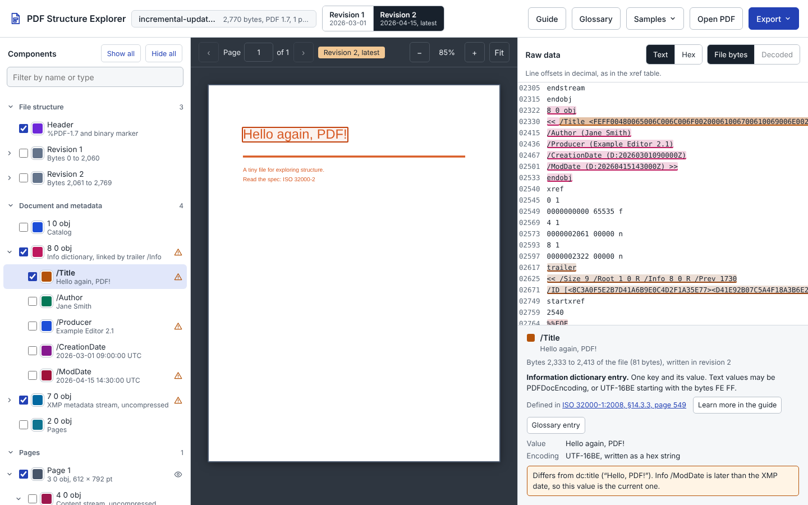

# PDF Structure Explorer


An educational, browser-based tool that shows how a PDF is built. Open any PDF, select its components (header, objects, cross-reference data, trailers, revisions, pages, fonts, metadata, signatures and more) and see each one outlined on the rendered page and highlighted in the file's raw bytes at the same time.

It's designed for digital forensic examiners who want to understand PDF structure at the byte level. It comes with a guide, *Inside a PDF: a structural guide for digital forensic examiners*, and eight purpose-built teaching samples.



## Contents

- [What it is, and what it isn't](#what-it-is-and-what-it-isnt)
- [Files in this folder](#files-in-this-folder)
- [Getting started](#getting-started)
- [Using the explorer](#using-the-explorer)
- [The guide: Inside a PDF](#the-guide-inside-a-pdf)
- [Teaching samples](#teaching-samples)
- [Exporting](#exporting)
- [Browser support and requirements](#browser-support-and-requirements)
- [Limitations](#limitations)
- [Privacy and evidence handling](#privacy-and-evidence-handling)
- [Verifying downloads](#verifying-downloads)
- [Licensing and third-party components](#licensing-and-third-party-components)
- [Disclaimer](#disclaimer)
- [Author](#author)

## What it is, and what it isn't

The explorer is a **learning tool**. It shows what a PDF contains and where each part sits in the file, explains each structure in plain language, and cites the clause that defines it in the PDF standard. It flags a few structural inconsistencies, such as cross-reference offsets that don't point at their objects, so they can be studied.

It is **not an analysis tool**. It doesn't score files, interpret findings or reach conclusions, and a file that looks clean in it has not been validated. For analysis, use the [PDF Forensics Suite](../Application); to learn to verify findings by hand with independent tools, use the [PDF Forensics Examiner Course](../Course).

## Files in this folder

| File | Description |
|---|---|
| `pdf-structure-explorer.html` | The explorer. A single, self-contained HTML file that includes the guide and the teaching samples. |
| `Inside-a-PDF-guide.pdf` | The PDF edition of the guide (30 pages). The same file is built into the explorer as a sample. |
| `SHA256SUMS.txt` | SHA-256 hashes of the two files above. |
| `screenshot.png` | The screenshot used in this README. |

## Getting started

1. Download [`pdf-structure-explorer.html`](pdf-structure-explorer.html). On GitHub, open the file and use **Download raw file**: viewing it on github.com shows its source code, not the app.
2. Open it in a recent browser.
3. Choose **Open PDF**, drag a PDF onto the page, or pick a teaching sample from **Samples**.

There is nothing to install. If GitHub Pages is enabled for this repository, the explorer can also be opened directly at `https://jjrboucher.github.io/PDF-Forensics/PDF%20Explorer/pdf-structure-explorer.html`.

New to PDF structure? Choose **Guide**, read *How to use this guide*, and follow the **Try it** exercises.

## Using the explorer

The window has three panes.

- **Components (left).** Lists the file's structure in groups:
  - **File structure:** the header and each revision with its cross-reference data, trailer, startxref and %%EOF.
  - **Document and metadata:** the catalog, information dictionary, XMP metadata, signatures, actions, outlines and the page tree.
  - **Pages:** each page with its content streams, text objects, paths, images and annotations.
  - **Resources:** fonts, images and other resources, with their components.
  - **Other objects:** everything else.
  - **Replaced or deleted in a later revision.**

  Each component has a checkbox to highlight it and a colour swatch to choose its colour. An eye icon marks components visible on a page; a warning icon marks inconsistencies, and metadata fields that differ between the information dictionary and XMP.
- **Page view (centre).** The rendered page, with a box around each ticked component that has a position on the page. Clicking a box selects that component.
- **Raw data and details (right).** The file's bytes in **Text** or **Hex** view, with every ticked component tinted in its colour. **Decoded** shows the uncompressed contents of a stream; components inside compressed streams, such as text objects or objects stored in object streams, are highlighted there. Below the bytes, the details panel explains the selected component. It shows its exact byte range, the clause that defines it, what it refers to and what refers to it, and checks such as whether an offset points where it should.

Other features:

- **Revisions.** For files with incremental updates, the revision switcher shows the document as it was at each `%%EOF`. It renders the earlier page, lists only the objects that existed then, and greys out the bytes added later.
- **Glossary.** Every kind of component found in the open file, with counts, definitions, "In this file" links, and citations matched to the file's PDF version. PDF 1.x files cite ISO 32000-1:2008 by clause and page; PDF 2.0 files cite ISO 32000-2:2020. It can open in a new tab.
- **Guide.** Opens *Inside a PDF* inside the app or in a new tab. Each component's details panel and each glossary entry links to the relevant section.

## The guide: Inside a PDF

*Inside a PDF: a structural guide for digital forensic examiners* explains PDF structure in technical detail, written for examiners. It is built into the explorer and is also available as [`Inside-a-PDF-guide.pdf`](Inside-a-PDF-guide.pdf).

1. Reading a PDF
2. Objects
3. File layout
4. Compressed structure
5. Incremental updates and revisions
6. The document
7. Page content
8. Fonts
9. Metadata
10. Other features you will meet: linearization, encryption, embedded files, actions and JavaScript, forms, digital signatures
11. Anomalies and what they can indicate
12. Reference: PDF versions, where each topic is defined, sources

Chapters include **Forensic notes**, which explain why a structure matters to an examination together with its common innocent explanations, and **Try it** exercises that open a teaching sample. Clause references cite both ISO 32000-1:2008 (with page numbers) and ISO 32000-2:2020.

The PDF edition is itself a teaching sample. It was built to contain embedded font subsets, bookmarks, internal and external links, information dictionary and XMP metadata, an attached file, object streams with a cross-reference stream, and an incremental update. Open it in the explorer to find each of them.

The free sources the guide relies on:

- ISO 32000-1:2008 (PDF 1.7), hosted by Adobe with the same page and clause numbers as the ISO edition: <https://opensource.adobe.com/dc-acrobat-sdk-docs/pdfstandards/PDF32000_2008.pdf>
- ISO 32000-2:2020 (PDF 2.0), free from the PDF Association after registration: <https://pdfa.org/sponsored-standards>
- PDF Association specification archive (PDF 1.0 to 2.0): <https://pdfa.org/resource/pdf-specification-index/>
- Arlington PDF Model: <https://github.com/pdf-association/arlington-pdf-model>

## Teaching samples

Eight small PDFs are built into the explorer (**Samples** menu, or the start screen). Each one was written so that the feature it teaches is present and easy to find.

| Sample | What it shows |
|---|---|
| Incremental update | Two revisions: the second changes the page and the information dictionary but not the XMP. |
| Object streams | Objects packed into a compressed object stream, with a cross-reference stream instead of a table. |
| Linearized | Fast web view: a first-page section, and two `%%EOF` markers in one revision. |
| Encrypted | AES-256 with an empty user password: the structure is readable, the streams are not. |
| Signed | A real digital signature made with a self-signed teaching certificate, plus a comment added after signing. The signed byte ranges and the excluded signature value can be highlighted. |
| Attachment and actions | An attached file, a JavaScript open action (it only displays a message), a bookmark, a link annotation and a file attachment annotation. |
| Anomalies | A stray `%%EOF`, a wrong cross-reference offset, a `/Length` that doesn't match its data, an unreferenced object, a version mismatch and data after the final `%%EOF`. Deliberately damaged. |
| This guide (PDF edition) | The guide itself, with the features listed above. |

Because the signing certificate is self-signed, signature validators will report that the signer's identity can't be trusted. That is expected: the sample teaches structure, not trust.

## Exporting

**Export** offers two outputs:

- **Interactive report:** a single HTML file containing the explorer, the PDF and your current selections and colours. It opens in any browser and works like the explorer itself, including the guide and glossary.
- **Printable summary:** a static document with an overview of the file, a revisions table, structural checks, a count of each kind of component, an information dictionary and XMP comparison, and the glossary. Open it in a browser and print or save it as PDF.

## Browser support and requirements

- A recent version of Chrome, Edge, Firefox or Safari. The explorer uses the browser's built-in decompression to read compressed streams.
- An internet connection for the page preview: the explorer loads [pdf.js](https://mozilla.github.io/pdf.js/) 3.11.174 from cdnjs. It also loads its fonts from Google Fonts. Without a connection, the components, raw data, details, glossary and guide still work; the page view shows a message instead of the page.
- Files of tens of megabytes work well; very large files may be slow to open.

## Limitations

- **Text-object boxes** on the page are estimated from font widths, so they can be slightly off.
- **Encrypted files** show their full structure, but stream contents can't be decoded.
- **Signatures** are shown structurally; they are not verified cryptographically.
- **Content streams** list up to 4,000 drawing objects each; the rest are grouped into one entry.
- **The glossary** counts drawing objects on the first 50 pages only, and says so.
- **ISO 32000-1 page links** assume the eight pages of front matter in Adobe's copy. If a link lands a few pages off, they will all be off by the same amount.
- **Arlington links.** Some links to the Arlington PDF Model follow its naming convention but couldn't be individually confirmed.
- **New tabs.** In some hosted or sandboxed environments, opening the glossary or guide in a new tab may be blocked; both remain available in the main window.

## Privacy and evidence handling

PDFs are read entirely in the browser. Nothing is uploaded, and the file you open is never modified.

An **interactive report** export contains a complete copy of the PDF, encoded inside the HTML file. Treat it with the same care as the original evidence file, and record it in your case notes if you create one.

## Verifying downloads

[`SHA256SUMS.txt`](SHA256SUMS.txt) lists the SHA-256 hashes of the explorer and the PDF edition of the guide.

```bash
# macOS / Linux
sha256sum pdf-structure-explorer.html Inside-a-PDF-guide.pdf

# Windows (PowerShell)
Get-FileHash pdf-structure-explorer.html, Inside-a-PDF-guide.pdf -Algorithm SHA256
```

The values must match those in `SHA256SUMS.txt`.

## Licensing and third-party components

- **The explorer application** (`pdf-structure-explorer.html`, apart from the guide and sample content it contains) is licensed under the [Apache License, Version 2.0](../Application/LICENSE), the same terms as the PDF Forensics Suite.
- **The guide *Inside a PDF*** (its text in the explorer and `Inside-a-PDF-guide.pdf`) is licensed under [CC BY 4.0](../Course/LICENSE). Suggested attribution: "Inside a PDF" by Jacques Boucher, used under CC BY 4.0. Source: github.com/jjrboucher/PDF-Forensics

Third-party components, which remain under their own licenses:

| Component | Use | License |
|---|---|---|
| [pdf.js](https://github.com/mozilla/pdf.js) 3.11.174 (Mozilla) | Page rendering; loaded from cdnjs at run time, not redistributed | Apache 2.0 |
| IBM Plex Sans and JetBrains Mono | Interface fonts; loaded from Google Fonts at run time | SIL Open Font License 1.1 |
| Liberation Sans | Embedded (subset) in the PDF edition of the guide | SIL Open Font License 1.1 |
| DejaVu Sans Mono | Embedded (subset) in the PDF edition of the guide | DejaVu Fonts License (Bitstream Vera) |

## Disclaimer

The explorer, its guide and its samples are provided free of charge and "as is," without warranty of any kind. They are intended to help examiners learn, not to replace a qualified examiner's judgment, and nothing they display is a determination about a document's authenticity. See the [full disclaimer](../README.md#disclaimer) in the repository README.

## Author

- **Author:** Jacques Boucher
- **Email:** jjrboucher@gmail.com
- **Repository:** [https://github.com/jjrboucher/PDF-Forensics](https://github.com/jjrboucher/PDF-Forensics)
